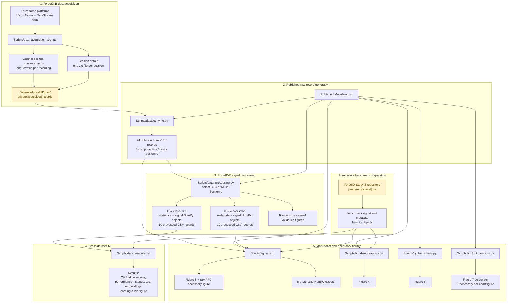

# ForceID-B Dataset

> Python source code accompanying **ForceID-B - A diverse walking ground reaction force dataset acquired in a public indoor setting**.

[](LICENSE.txt)
[](https://doi.org/10.25909/33000368)
[](https://doi.org/10.5281/zenodo.21446085)

## Overview

ForceID-B is a large-scale walking ground reaction force (GRF) dataset acquired in a public university building under largely unconstrained field conditions. It contains 1,362 walking trials collected across 336 sessions from 173 healthy participants. Each trial contains three-dimensional GRF, three-dimensional ground reaction moment (GRM) and two-dimensional center-of-pressure (COP) measurements from three force platforms.

The dataset captures natural intra- and inter-individual variation associated with repeated sessions, clothing, footwear, carried objects and unconstrained foot placement. Partial foot contacts comprise 65% of the annotated footsteps, making ForceID-B a challenging resource for developing, benchmarking and externally validating gait analysis methods intended for use beyond controlled laboratory settings.

This repository accompanies the ForceID-B Data Descriptor manuscript and provides the Python source code to:

- document the original force platform acquisition software;
- show how the original per-trial files were reformatted into the published raw CSV records;
- derive the published `ForceID-B_CFC` and `ForceID-B_RS` processed subsets;
- implement cross-dataset gait recognition experiments using machine learning (ML) models to technically validate the dataset; and
- generate manuscript and accessory figures.

> [!IMPORTANT]
> The ForceID-B data records are distributed separately on [Figshare](https://doi.org/10.25909/33000368) <sup>[1](#ref-1)</sup>. The GitHub repository contains source code and selected supporting objects, not the 2.9 GB published dataset.

## Repository objectives

This repository is intended to help users:

- inspect and understand the ForceID-B acquisition, processing and analysis workflow;
- reproduce the published processed subsets from the released raw CSV records;
- interrogate data quality and visualise measurements at key processing stages;
- investigate alternative signal processing parameters and methods;
- adapt the ML implementation for related multi-dataset gait recognition experiments;
- regenerate figures (when required public or repository-provided inputs are available); and
- reuse the modular code for related biomechanics, signal processing and ML applications.

The repository is a transparent research reference implementation rather than a turnkey software package. Limitations of use based on requirements for external data or inputs that cannot be publicly distributed are identified below.

## Repository contents

| Path           | Contents                                                                                                     |
|----------------|--------------------------------------------------------------------------------------------------------------|
| `DataLoaders/` | PyTorch dataset and data loader classes for single-input and dual-input ML models                            |
| `Datasets/`    | Repository-provided benchmark dataset objects and directory structure for user-created/downloaded data files |
| `Figures/`     | Manuscript and accessory figures written by processing and figure scripts                                    |
| `Losses/`      | Pairwise distance metric utilities, and implementation for evaluating ML model loss and accuracy             |
| `Models/`      | Fully connected, convolutional-transformer and Siamese neural network definitions                            |
| `PrePro/`      | Signal processing utility for bidirectional Butterworth low-pass filtering                                   |
| `Results/`     | Test set trial identifiers, cross-validation histories and model learning curve figures for ML experiments   |
| `Scripts/`     | Modular scripts for the data acquisition, writing, processing, analysis and visualisation workflow           |
| `TrainEval/`   | Model training, validation, testing and early stopping utilities                                             |
| `Utils/`       | Reproducibility, serialisation, date-time and metadata loading utilities                                     |
| `env.yaml`     | Conda environment export named `GaitReID`                                                                    |
| `LICENSE`      | Creative Commons Attribution-NonCommercial 4.0 International license                                         |
| `RECORD.jpg`   | Image used for the record button in the acquisition GUI                                                      |

The tracked repository also contains `.idea/` PyCharm project metadata. It is omitted from the user-facing structure below because it is not required to understand or reuse the scientific workflow.

## Repository structure and expected data layout

The tree below distinguishes tracked source code paths from external, private and generated data paths expected by the scripts.

```text
ForceID-B-Dataset/
├── DataLoaders/
│   └── __init__.py
├── Losses/
│   └── __init__.py
├── Models/
│   └── __init__.py
├── PrePro/
│   └── __init__.py
├── TrainEval/
│   └── __init__.py
├── Utils/
│   └── __init__.py
│
├── Scripts/
│   ├── data_acquisition_GUI.py
│   ├── dataset_write.py
│   ├── data_processing.py
│   ├── data_analysis.py
│   ├── fig_sigs.py
│   ├── fig_demographics.py
│   ├── fig_bar_charts.py
│   └── fig_foot_contacts.py
│
├── Datasets/
│   ├── gb-all/
│   │   └── Objects/                  # Prepared Gutenberg NumPy objects
│   ├── gr-all/
│   │   └── Objects/                  # Prepared GaitRec NumPy objects
│   │
│   ├── ai-all/                       # Prepared AIST NumPy objects required by some scripts (not distributed)
│   │   └── Objects/
│   ├── fi-all/                       # Prepared NumPy objects for private version of ForceID-A (not distributed)
│   │   └── Objects/
│   │
│   ├── fi-b-all/                     # Create when setting up ForceID-B
│   │   ├── ID dirs/                  # Original per-trial acquisition files (private)
│   │   └── Spreadsheets/             # Download raw CSV records + Metadata.csv here
│   ├── fi-b-cfc/                     # Created/downloaded ForceID-B_CFC content
│   │   ├── Objects/                  # Generated NumPy objects
│   │   └── Spreadsheets/             # Published processed CSV records
│   ├── fi-b-rs/                      # Created/downloaded ForceID-B_RS content
│   │   ├── Objects/                  # Generated NumPy objects
│   │   └── Spreadsheets/             # Published processed CSV records
│   └── fi-b-pfc-valid/
│       └── Objects/                  # Intermediate objects generated by fig_sigs.py
│
├── Figures/                          # Generated PDF figures
├── Results/                          # ML experiment outputs are written directly here
├── env.yaml
├── LICENSE.txt
├── README.md
└── RECORD.jpg
```

> [!NOTE]
> Dataset identifiers in the code are abbreviated: `ai-all` = AIST, `gb-all` = Gutenberg, `gr-all` = GaitRec (healthy subset), `fi-all` = ForceID-A and `fi-b-rs` = ForceID-B_RS.

## Code workflow

The repository implements five connected stages: data acquisition, dataset publication, signal processing, machine learning analysis and figure generation.



### Workflow notes

- `dataset_write.py` reads `Metadata.csv` and the private per-trial CSV files, not the session detail text files.
- `data_processing.py` processes one selected subset at a time, controlled by the `fib_subset_to_process` parameter in Section 1. Run it with `CFC` and `RS` settings to generate both published subsets.
- The main Figure 7 illustration was assembled externally. `fig_foot_contacts.py` generates the quantitative counts, colour mapping, colour bar and accessory bar charts.
- All scripts use repository-relative paths such as `./Datasets`, `./Figures` and `./Results`. Use the repository root as the working directory and create required output directories before execution.
- CV = cross-validation and PFC = partial foot contact.

## Getting started

### Intended audience

This repository is primarily intended for researchers and practitioners working in biomechanics, gait analysis, biomedical engineering, signal processing, ML, pattern recognition and biometric recognition.

The scripts are extensively documented through preambles, numbered sections and step-by-step comments. The README is therefore intended to orient users to the project structure, dependencies, data placement and execution limitations rather than duplicate the inline documentation.

### Benchmark dataset prerequisites

Several scripts load processed benchmark dataset objects originally generated by the four `prepare_[dataset].py` scripts in the companion [ForceID-Study-2 repository](https://doi.org/10.5281/zenodo.14013382) <sup>[2](#ref-2)</sup> for a previous study by Duncanson et al. (2024)<sup>[3](#ref-3)</sup>.

Each preparation script reads the corresponding raw data and metadata records and saves processed NumPy arrays. The present repository expects the following identifiers and signal object names:

| Dataset   | Directory identifier | Required processed signal objects  |
|-----------|----------------------|------------------------------------|
| AIST      | `ai-all`             | `sigs_pro_r.npy`, `sigs_pro_l.npy` |
| Gutenberg | `gb-all`             | `sigs_pro_r.npy`, `sigs_pro_l.npy` |
| GaitRec   | `gr-all`             | `sigs_pro_r.npy`, `sigs_pro_l.npy` |
| ForceID-A | `fi-all`             | `sigs_pro_r.npy`, `sigs_pro_l.npy` |

The ForceID-Study-2 objects named `sigs_all_[side]_pro.npy` were renamed to `sigs_pro_[side].npy` in this repository, where `[side]` is `r` or `l`.

### Installation

Clone the repository:

```bash
git clone https://github.com/kayneduncanson1/ForceID-B-Dataset.git
cd ForceID-B-Dataset
```

Create and activate the Conda environment:

```bash
conda env create -f env.yaml
conda activate GaitReID
```

> [!WARNING]
> The current `env.yaml` is a full Windows environment export with platform-specific build strings and an author-local `prefix:` path. Before treating the environment file as portable, remove the final `prefix:` entry and preferably replace the full export with a cross-platform environment specification containing only direct dependencies.

### Additional acquisition software requirement

`Scripts/data_acquisition_GUI.py` imports `vicon_dssdk` and communicates with Vicon Nexus through the Vicon DataStream SDK. This module is not included in `env.yaml`. Running the acquisition GUI therefore requires compatible Vicon software and a separately installed DataStream SDK Python module according to the official Vicon documentation.

The GUI also loads `RECORD.jpg` from the repository root for the record button icon.

### Obtaining and placing the ForceID-B data

Download the published data records from [Figshare](https://doi.org/10.25909/33000368) <sup>[1](#ref-1)</sup>, then create the required directories and place files as follows:

| Content                                                         | Expected path                                 |
|-----------------------------------------------------------------|-----------------------------------------------|
| `Metadata.csv`                                                  | `Datasets/fi-b-all/Spreadsheets/Metadata.csv` |
| 24 raw files named `ForceID-B_<component>_FP<platform>_raw.csv` | `Datasets/fi-b-all/Spreadsheets/`             |
| 10 processed `ForceID-B_CFC` CSV records                        | `Datasets/fi-b-cfc/Spreadsheets/`             |
| 10 processed `ForceID-B_RS` CSV records                         | `Datasets/fi-b-rs/Spreadsheets/`              |

The published ForceID-B records are CSV files. ForceID-B NumPy objects are generated locally by `Scripts/data_processing.py` and saved under the relevant `Objects/` directory.

### Reproducibility and execution status

| Script                            | Public execution status                                              | Main limitation or requirement                                                                                                   |
|-----------------------------------|----------------------------------------------------------------------|----------------------------------------------------------------------------------------------------------------------------------|
| `Scripts/data_acquisition_GUI.py` | Environment- and hardware-dependent                                  | Requires Vicon Nexus, force platforms and `vicon_dssdk` module                                                                   |
| `Scripts/dataset_write.py`        | Demonstrative only                                                   | Requires the private original per-trial files in `ID dirs/` (or a compatible substitute created using `data_acquisition_GUI.py`) |
| `Scripts/data_processing.py`      | Reproducible after data setup                                        | Requires the published raw CSV records and `Metadata.csv`; run separately for `CFC` and `RS`                                     |
| `Scripts/data_analysis.py`        | Exact experiment not publicly reproducible                           | Required objects for AIST and private version of ForceID-A are not distributed                                                   |
| `Scripts/fig_sigs.py`             | Exact figure not publicly reproducible without all benchmark objects | Requires AIST, Gutenberg, GaitRec and private-version ForceID-A signal objects, plus ForceID-B data                              |
| `Scripts/fig_demographics.py`     | Exact figure not publicly reproducible without all benchmark objects | Requires demographic metadata objects for all four benchmark datasets                                                            |
| `Scripts/fig_bar_charts.py`       | Reproducible after metadata setup                                    | Requires only the published ForceID-B `Metadata.csv`                                                                             |
| `Scripts/fig_foot_contacts.py`    | Computational outputs reproducible after metadata setup              | Generates the colour bar and accessory plot; the main Figure 7 illustration was assembled externally                             |

Researchers can conduct indirect replications of the ML workflow by excluding AIST, replacing the private ForceID-A version with the public release, and updating dataset configuration and participant label offsets accordingly.

## Script reference

The scripts are designed to be read and modified as research code. Each script contains an explanatory preamble, numbered sections and inline comments describing assumptions, intermediate objects and implementation decisions.

### `Scripts/data_acquisition_GUI.py`

**Purpose.** Provides the PyQt5 graphical user interface used to acquire the original ForceID-B force platform measurements through Vicon Nexus and the Vicon DataStream SDK.

| Category          | Details                                                                                                  |
|-------------------|----------------------------------------------------------------------------------------------------------|
| Manual inputs     | Three-digit participant ID, session number, body mass with objects, body mass without objects and height |
| Instrument input  | Real-time device data streamed from three force platforms through `vicon_dssdk`                          |
| Output directory  | `Datasets/fi-b-all/ID dirs/<participant ID>/`                                                            |
| Session output    | `<ID>_S<session>.txt`, written once per session to avoid accidental overwrite                            |
| Trial output      | `<ID>_S<session>_<YY_MM_DD-HH_MM_SS>.csv`, containing approximately 20 seconds of measurements           |
| Recorded channels | Eight channels per force platform: `Fx`, `Fy`, `Fz`, `Mx`, `My`, `Mz`, `Cx` and `Cy`                     |

The GUI validates the expected entry format before writing session details. It records the three force platforms in the device order returned by the Vicon client and then rearranges them into force platform order before writing a 24-channel trial array.

> [!CAUTION]
> This script documents the study acquisition implementation. It is not a hardware-independent acquisition application and has not been generalised for other Vicon configurations, device names, channel orders, sampling settings or experimental protocols.

### `Scripts/dataset_write.py`

**Purpose.** Demonstrates how the private per-trial acquisition files were reorganised into the 24 published raw ForceID-B data records.

| Category            | Details                                                                                        |
|---------------------|------------------------------------------------------------------------------------------------|
| Metadata input      | `Datasets/fi-b-all/Spreadsheets/Metadata.csv`                                                  |
| Measurement input   | Original per-trial CSV files under `Datasets/fi-b-all/ID dirs/<participant ID>/`               |
| Output              | One CSV record for every combination of eight directional components and three force platforms |
| Output naming       | `ForceID-B_<component>_FP<platform>_raw.csv`                                                   |
| Fixed signal length | 20,100 frames; shorter trials are end-padded with `NaN`                                        |

Each output file places participant ID, session number and trial number in the first three rows, followed by the padded measurement frames. The original acquisition directory is private and is represented only as an expected path in the public workflow.

> [!NOTE]
> The implementation assumes the published dataset dimensions and file naming conventions. Adaptations for other datasets should revise the fixed signal length, expected channel count, metadata columns and filename matching logic.

### `Scripts/data_processing.py`

**Purpose.** Defines and processes either `ForceID-B_CFC` or `ForceID-B_RS`, saves the corresponding NumPy and published CSV representations, and generates participant-level figures for visual validation.

#### Subsets

| Subset          | Definition                                                                                                                    | Primary downstream use            |
|-----------------|-------------------------------------------------------------------------------------------------------------------------------|-----------------------------------|
| `ForceID-B_CFC` | Trials containing at least two consecutive complete foot contacts; each sample comprises the first two complete stance phases | Signal visualisation and Figure 8 |
| `ForceID-B_RS`  | Two random samples from every eligible `ForceID-B_CFC` participant with at least two samples                                  | Cross-dataset ML testing          |

#### Main inputs and outputs

| Type                        | Path or filename                                                                                      |
|-----------------------------|-------------------------------------------------------------------------------------------------------|
| Metadata input              | `Datasets/fi-b-all/Spreadsheets/Metadata.csv`                                                         |
| Raw signal inputs           | `Datasets/fi-b-all/Spreadsheets/ForceID-B_<component>_FP<platform>_raw.csv`                           |
| CFC metadata object         | `Datasets/fi-b-cfc/Objects/metadata_cfc.npy`                                                          |
| RS metadata object          | `Datasets/fi-b-rs/Objects/metadata_rs.npy`                                                            |
| Basic RS ML metadata        | `trial_names.npy`, `labels.npy`, `ids.npy`, `counts_samples.npy` under `Datasets/fi-b-rs/Objects/`    |
| Processed signal objects    | `sigs_pro_r.npy` and `sigs_pro_l.npy` under the selected subset's `Objects/` directory                |
| Published processed records | `ForceID-B_<subset>_<component>_<side>_pro.csv` under the selected subset's `Spreadsheets/` directory |
| Validation figures          | Raw `Fz` overview and participant-level raw/processed PDF figures under `Figures/`                    |

#### Default processing settings

The principal settings are centralised in Section 1 of the script.

| Parameter                    |                      Default | Meaning                                                             |
|------------------------------|-----------------------------:|---------------------------------------------------------------------|
| `fib_subset_to_process`      |                        `CFC` | Selected output subset; change to `RS` for the random sample subset |
| `n_rs`                       |                          `2` | Random samples selected per eligible participant for `ForceID-B_RS` |
| `n_ids_bm`                   |                       `1050` | Participant label offset based on the four benchmark datasets       |
| `channels`                   | `Fx`, `Fy`, `Fz`, `Cx`, `Cy` | Components retained to match the benchmark datasets                 |
| `fz_thresh`                  |                       `50 N` | Vertical GRF threshold for stance segmentation                      |
| `n_frames_cal`               |                        `500` | Unloaded baseline frames used for selected offset corrections       |
| `n_frames_stance_buffer_grf` |                         `20` | GRF buffer at each end of the approximate stance period             |
| `portion_to_exclude_cop`     |                       `0.05` | COP proportion excluded from each end of stance                     |
| `sampling_rate`              |                    `1000 Hz` | Original ForceID-B sampling rate                                    |
| `sampling_rate_dns`          |                     `250 Hz` | Down-sampled rate used across datasets                              |
| `filt_order`                 |                          `4` | Bidirectional Butterworth filter order                              |
| `filt_cutoff`                |                      `30 Hz` | Low-pass cutoff frequency                                           |
| `filt_n_frames_pad`          |                         `40` | `filtfilt` padding length                                           |
| `len_interp`                 |                        `100` | Time normalised frames per stance phase                             |
| `percent_ss_split`           |                        `39%` | Stance side detection heuristic location within the stance phase    |

#### Processing sequence

The implementation:

1. selects trials with two consecutive complete foot contacts;
2. optionally selects the random sample subset;
3. reads the first two force platforms containing consecutive complete contacts;
4. retains 3D GRF and 2D COP channels and excludes GRM;
5. transforms measurements to a right-handed walkway coordinate system;
6. applies targeted baseline offset correction to identified trials;
7. segments GRF and COP using the vertical GRF threshold and separate boundary rules;
8. down samples to 250 Hz and applies bidirectional low-pass filtering;
9. time normalises each stance phase to 100 frames;
10. translates COP to begin at `(0, 0)`;
11. detects stance side from mediolateral GRF at 39% stance;
12. validates derived stance side labels against video metadata; and
13. transforms left stance mediolateral axes to a common foot biomechanical coordinate system.

The script contains the specific trial identifiers for the offset corrections applied in the manuscript workflow. Those identifiers and correction rules should be re-evaluated before applying the pipeline to modified or newly acquired data.

### `Scripts/data_analysis.py`

**Purpose.** Implements the cross-dataset gait recognition experiments used to assess whether gait features learned from four benchmark datasets transfer to `ForceID-B_RS`.

#### Current dataset configuration

```python
config = [
    'fi-all',   # ForceID-A
    'gr-all',   # GaitRec
    'gb-all',   # Gutenberg
    'ai-all',   # AIST
    'fi-b-rs',  # ForceID-B_RS test set
]
```

The first four datasets are aggregated for model development. `ForceID-B_RS` is held out as the test dataset and is repeated as the same test set across all five cross-validation folds.

#### ML preparation and evaluation

The script:

- loads trial identifiers, participant labels, sample counts and bilateral processed signals for every dataset;
- shuffles samples within participants and allocates benchmark participants to five training/validation folds;
- balances validation data according to the minimum sample count per participant;
- retains imbalanced training data but uses a weighted random sampler;
- fits a separate `StandardScaler` to each directional component using the training fold and applies it to validation and test folds;
- concatenates right and left stance phases along the sequence dimension for the published single-input neural network implementation;
- optimises a triplet margin objective (loss/cost function) with batch-hard mining;
- evaluates embeddings using the random subset search method <sup>[3](#ref-3), [4](#ref-4)</sup>; and
- saves fold-level outputs for model loss, accuracy and test set embeddings.

#### Principal experimental parameters

| Parameter                       |   Default | Meaning                                                                 |
|---------------------------------|----------:|-------------------------------------------------------------------------|
| `n_folds`                       |       `5` | Participant-level cross-validation folds for benchmark development data |
| `arch`                          | `-----2F` | Two-layer fully connected architecture; alternative: `3C1T-2F`          |
| `single_network`                |    `True` | Concatenate bilateral stance phases and process them through one model  |
| `bs`                            |     `512` | Training batch size                                                     |
| `epochs`                        |    `1000` | Maximum training epochs                                                 |
| `es_patience`                   |      `20` | Early stopping patience based on validation loss                        |
| `lr`                            |  `0.0001` | Learning rate for Adam (AMSGRAD) optimiser                              |
| `m`                             |     `0.3` | Triplet margin and evaluation margin for the distance metric            |
| `cuda_tr`, `cuda_va`, `cuda_te` |   `False` | Independent CUDA device controls for training, validation and testing   |

The alternative convolutional-transformer neural network (`3C1T-2F`) architecture contains three one-dimensional convolutional blocks, one transformer encoder layer and two fully connected layers. Both architectures output gait embeddings rather than participant-class logits.

When `single_network=False`, the code constructs a Siamese variant of the specified neural network architecture with shared model weights. Right and left stance phases are supplied separately and the current `SiameseNet` model class implementation fuses their output features through addition. Other example feature fusion operations are included as commented alternatives in `Models/__init__.py`.

> [!WARNING]
> The Siamese path is yet to be validated via a final debug check and is thus marked with a corresponding TODO.

#### Results

The script writes outputs directly to `Results/`, including:

- per-dataset shuffled trial identifiers;
- training, validation and test fold definitions;
- training, validation and test losses;
- training, validation and test accuracies;
- test set embeddings in PyTorch `.pth` format;
- optional model and optimiser checkpoints when the relevant save statement is uncommented; and
- a PDF figure of loss and accuracy curves for training and validation.

Files with a `.txt` suffix in `Results/` are binary Python pickle files written through `Utils.save_list`; they are not plain-text records. Load them with `Utils.load_list` and never unpickle files from an untrusted source.

### `Scripts/fig_sigs.py`

**Purpose.** Generates manuscript Figure 8 by comparing:

1. means and standard deviations from the AIST, Gutenberg, GaitRec and ForceID-A benchmark datasets;
2. processed complete foot contact signals from `ForceID-B_CFC`; and
3. processed partial foot contact signals selected from two random ForceID-B participants.

| Category                             | Details                                                                                      |
|--------------------------------------|----------------------------------------------------------------------------------------------|
| Benchmark inputs                     | `sigs_pro_r.npy` and `sigs_pro_l.npy` for `ai-all`, `gb-all`, `gr-all` and `fi-all`          |
| ForceID-B inputs                     | `metadata_cfc.npy`, CFC bilateral signal objects, `Metadata.csv` and raw GRF/COP CSV records |
| ForceID-B random participant IDs     | `36` and `151` in the current implementation                                                 |
| Minimum approximate contact duration | `200` frames                                                                                 |
| Intermediate outputs                 | `Datasets/fi-b-pfc-valid/Objects/sigs_valid.npy` and `metadata_valid.npy`                    |
| Accessory output                     | `Figures/ForceID-B_PFC_Fz_raw.pdf`                                                           |
| Main output                          | `Figures/fig 8 (sigs).pdf`                                                                   |

The partial contact processing is intentionally less complete than the CFC pipeline: it does not apply trial-specific offset correction, stance side detection or mediolateral foot coordinate transformation. This reflects the technical validation comparison described in the manuscript.

The current plotting logic assumes exactly two selected participants, uses axis limits tuned to those participants and includes a legend section that was post-edited externally. Generalise these assumptions before substituting other participants.

### `Scripts/fig_demographics.py`

**Purpose.** Generates manuscript Figure 4 comparing age, height, mass and sex distributions in ForceID-B and the four benchmark datasets.

| Category         | Details                                                                                                                                     |
|------------------|---------------------------------------------------------------------------------------------------------------------------------------------|
| ForceID-B input  | `Datasets/fi-b-all/Spreadsheets/Metadata.csv`                                                                                               |
| Benchmark inputs | NumPy objects: trial identifiers, participant labels, sample counts, ages, sexes, masses, heights, footwear categories and speed categories |
| GaitRec option   | `gr-all` by default; `gr-sho` can be selected if compatible objects are supplied                                                            |
| Output           | `Figures/fig 4 (demographics).pdf`                                                                                                          |

The script contains dataset-specific missing value and participant index handling. These assumptions must be reviewed when replacing benchmark versions or changing participant ordering.

### `Scripts/fig_bar_charts.py`

**Purpose.** Generates manuscript Figure 6, comprising ten horizontal bar charts that summarise:

- sessions per participant;
- trials per participant;
- object categories brought to sessions;
- object categories carried during trials;
- absolute and body mass relative object mass;
- footwear;
- top clothing;
- bottom clothing; and
- top-to-bottom clothing.

| Category | Details                                       |
|----------|-----------------------------------------------|
| Input    | `Datasets/fi-b-all/Spreadsheets/Metadata.csv` |
| Output   | `Figures/fig 6 (bar chart).pdf`               |

The figure selects the most common annotation categories and combines remaining categories into `Others`. Several bins and axis bounds reflect the published dataset and should be reviewed if the metadata record changes.

### `Scripts/fig_foot_contacts.py`

**Purpose.** Calculates foot contact category distributions used in manuscript Figure 7 and generates the computational components associated with that externally assembled illustration.

| Category                   | Details                                                 |
|----------------------------|---------------------------------------------------------|
| Input                      | `Datasets/fi-b-all/Spreadsheets/Metadata.csv`           |
| Main computational outputs | Category counts, normalised values and RGB colour codes |
| Colour bar output          | `Figures/fig 7 (foot strikes) cbar.pdf`                 |
| Accessory output           | `Figures/fig extra (foot strikes).pdf`                  |

The main heatmap illustration is not generated by this script. The script uses a fixed normalisation range of 0–1,500 counts and contains a hard-coded calculation of the partial foot contact percentage reported in the manuscript. Recalculate these values if the metadata changes.

## Reusable modules

| Module        | Main public objects                                                                                                                                   | Role                                                                     |
|---------------|-------------------------------------------------------------------------------------------------------------------------------------------------------|--------------------------------------------------------------------------|
| `DataLoaders` | `SingleDatasetLoaderLabels`, `SingleDatasetLoaderNoLabels`, `DualDatasetLoaderLabels`, `DualDatasetLoaderNoLabels`, `init_data_loaders_no_labs_va_te` | PyTorch loading for single-input and bilateral dual-input ML workflows   |
| `Models`      | `TwoF`, `PositionalEncoding`, `ThrCOneTTwoF`, `SiameseNet`                                                                                            | Neural network architectures and optional shared weight bilateral fusion |
| `Losses`      | `get_dists`, `EvalHard`                                                                                                                               | Pairwise Euclidean distance matrices and random subset search evaluation |
| `TrainEval`   | `AverageMeter`, `EarlyStopping`, `calc_acc_train`, `train_val`, `test`                                                                                | Training, validation, testing, early stopping and metric accumulation    |
| `PrePro`      | `butterworth_lowpass`                                                                                                                                 | Bidirectional Butterworth low-pass filtering through SciPy `filtfilt`    |
| `Utils`       | `convert_dt_to_iso`, `set_seed`, `save_list`, `load_list`, `extract_base_metadata_fib`, `load_base_metadata`, `load_full_metadata`                    | Date-time conversion, reproducibility, serialisation and metadata access |

`AverageMeter` is adapted from Torchreid by Zhou & Xiang (2019) <sup>[5](#ref-5)</sup>, `EarlyStopping` is adapted from Rath (2021) <sup>[6](#ref-6)</sup>, and `set_seed` is adapted from Maheshkar (2024) <sup>[7](#ref-7)</sup>.

## Data records and object conventions

### Published raw CSV records

There are 24 raw data files:

```text
8 directional components x 3 force platforms = 24 files
```

The component set is `Fx`, `Fy`, `Fz`, `Mx`, `My`, `Mz`, `Cx` and `Cy`. Files follow this convention:

```text
ForceID-B_<component>_FP<1|2|3>_raw.csv
```

Each file is oriented with trials across columns and the following records across rows:

1. `PARTICIPANT_ID`
2. `SESSION_NUMBER`
3. `TRIAL_NUMBER`
4. measurement frames 1–20,100

The first column contains row labels and the remaining 1,362 columns contain individual walking trials.

### Published processed CSV records

Each processed subset contains ten files:

```text
5 directional components x 2 stance sides = 10 files
```

Files follow this convention:

```text
ForceID-B_<CFC|RS>_<Fx|Fy|Fz|Cx|Cy>_<R|L>_pro.csv
```

Rows contain:

1. `PARTICIPANT_ID`
2. `SESSION_NUMBER`
3. `TRIAL_NUMBER`
4. `FORCE_PLATFORM_NUMBER`
5. time normalised frames 1–100

The number of sample columns depends on the selected subset.

### Processed NumPy signals

The principal processed arrays are:

```text
sigs_pro_r.npy    # shape: (N, 5, 100)
sigs_pro_l.npy    # shape: (N, 5, 100)
```

where `N` is the number of samples, five channels represent `Fx`, `Fy`, `Fz`, `Cx` and `Cy`, and 100 frames represent the time normalised stance phase.

For the default single-network ML path, corresponding right and left stance phases are concatenated along the sequence axis to create an input of shape `(N, 5, 200)`. For the Siamese path, the two `(N, 5, 100)` inputs remain separate.

### Basic ML metadata objects

| Filename             | Contents                                                       |
|----------------------|----------------------------------------------------------------|
| `trial_names.npy`    | Unique sample identifiers used to align and partition datasets |
| `labels.npy`         | Participant ID labels associated with samples                  |
| `ids.npy`            | Unique participant labels                                      |
| `counts_samples.npy` | Number of samples per participant                              |

Benchmark metadata objects additionally include `ages.npy`, `sexes.npy`, `masses.npy`, `heights.npy`, `footwear.npy` and `speeds.npy`.

### Missing values and matrix orientation

Raw signals with fewer than 20,100 frames are end-padded with IEEE floating-point `NaN` values. Spreadsheet software may display these values as empty cells, making a file appear ragged, but analysis environments that recognise `NaN` reconstruct the intended rectangular matrix.

`Metadata.csv` uses `NA` for unavailable or inapplicable entries. Common Python, MATLAB and R import functions can interpret these entries as missing values, although users should verify parser settings for their chosen software.

Because measurement frames are stored across rows and samples across columns, matrices need to be transposed to plot multiple samples using a conventional time-along-columns array layout.

### Metadata privacy

The published metadata contains annotations without source photographs and videos so that the dataset remains de-identified. Annotation requests can be addressed to corresponding authors ([Contact](#contact)).

## Running the workflows

### General execution pattern

Run commands from the repository root so that relative data paths, package imports and `RECORD.jpg` resolve consistently. Using Python's module mode also keeps the repository root on the import path:

```bash
python -m Scripts.<script_name_without_py>
```

Given that scripts generally do not create their output directories, ensure that the required `Datasets`, `Figures` and `Results` directories are present before execution.

### Generate the two processed ForceID-B subsets

1. Place `Metadata.csv` and all 24 raw CSV records under `Datasets/fi-b-all/Spreadsheets/`.
2. Ensure these output paths exist:

   ```text
   Datasets/fi-b-cfc/Objects/
   Datasets/fi-b-cfc/Spreadsheets/
   Datasets/fi-b-rs/Objects/
   Datasets/fi-b-rs/Spreadsheets/
   Figures/
   ```

3. In Section 1 of `Scripts/data_processing.py`, set:

   ```python
   fib_subset_to_process = 'CFC'
   ```

4. Run:

   ```bash
   python -m Scripts.data_processing
   ```

5. Change the setting to:

   ```python
   fib_subset_to_process = 'RS'
   ```

6. Run the script again.

The random seed is fixed at 42, so the default two random sample selection is deterministic under the supplied software implementation.

### Generate figures requiring only ForceID-B metadata

After placing `Metadata.csv`, run:

```bash
python -m Scripts.fig_bar_charts
python -m Scripts.fig_foot_contacts
```

These commands generate Figure 6 and the computational Figure 7 outputs, respectively.

### Generate benchmark dependent figures
Once `ForceID-B_CFC` has been generated and the workflow has been adapted to incorporate public versions of AIST and ForceID-A resulting in compatible benchmark NumPy objects (as per the [Reproducibility and execution status](#reproducibility-and-execution-status)), `fig_demographics.py` and `fig_sigs.py` can be run accordingly: 

```bash
python -m Scripts.fig_demographics
python -m Scripts.fig_sigs
```

### Run an ML replication based on the reference implementation

Once `ForceID-B_RS` has been generated and the workflow has been adapted to incorporate public versions of AIST and ForceID-A resulting in compatible benchmark NumPy objects (as per the [Reproducibility and execution status](#reproducibility-and-execution-status)), complete the following steps:

1. review `arch`, `single_network`, optimisation settings and device flags in Section 1 of `Scripts/data_analysis.py`;
2. ensure `Results/` exists; and
3. run:

   ```bash
   python -m Scripts.data_analysis
   ```

The model architectures provided in the current implementation are configured by modifying the `arch` variable definition as follows:

```python
arch = '-----2F'
```

and:

```python
arch = '3C1T-2F'
```

### Acquisition and publication demonstrations

With compatible hardware and software as per the [Reproducibility and execution status](#reproducibility-and-execution-status), `data_acquisition_GUI.py` can be run accordingly:

```bash
python -m Scripts.data_acquisition_GUI
```

Raw data records can be constructed as per the published ForceID-B records using `dataset_write.py` when compatible per-trial acquisition files are available:

```bash
python -m Scripts.dataset_write
```

## Configuration and reproducibility

### Random seeds

`Utils.set_seed` sets NumPy, Python, PyTorch and CUDA seeds, configures deterministic CuDNN behaviour and fixes `PYTHONHASHSEED`. The main processing and analysis scripts use seed 42 by default.

These measures are intended to maximise reproducibility but do not guarantee bitwise identical results across operating systems, hardware, CUDA/cuDNN implementations or substantially different package versions.

### Cached splits and shuffled identifiers

`data_analysis.py` creates shuffled participant sample lists and cross-validation split files only when their expected files do not already exist. Existing files are loaded and reused on subsequent runs.

After changing the random seed, dataset membership or split logic, remove or archive the corresponding `trial_names...txt` files in `Results/` before rerunning. Otherwise, the previous partitions will remain in effect.

### CPU and CUDA settings

Training, validation and testing have independent `cuda_tr`, `cuda_va` and `cuda_te` flags. They default to `False`, even though the exported environment includes a CUDA-enabled PyTorch build. Set these flags only after confirming compatible hardware, drivers and package builds.

### Output replacement

Many NumPy, CSV and PDF outputs are written to fixed filenames and may be replaced without an interactive confirmation. Preserve important generated results under versioned directories or filenames before rerunning modified code.

### Fonts and figure rendering

Figure scripts request Times New Roman and use Matplotlib's `tableau-colorblind10` style. Systems without the requested font may substitute another font, producing small layout differences. Some manuscript figures also underwent external post-processing, as identified in the relevant script sections.

## Relationship to ForceID-Study-2

This repository extends code from the companion ForceID-Study-2 repository <sup>[2](#ref-2)</sup>.

The main relationships are:

- `Scripts/data_processing.py` is based on the four benchmark `prepare_[dataset].py` scripts;
- `Scripts/data_analysis.py` is based on `main.py`;
- `Scripts/fig_demographics.py` adapts the corresponding demographic analysis approach; and
- metadata loading and related utilities in `Utils` follow equivalent ForceID-Study-2 functions.

The present repository introduces systematic changes to increase understanding and facilitate modification:

- repeated code was replaced with loops where practical;
- variable nomenclature was revised into hierarchical underscore-separated names, progressing from broad to specific meaning;
- scripts were organised into preambles and numbered sections with step-by-step comments; and
- modifiable parameters were centralised in Section 1 of major scripts and referenced later (rather than hard-coded at use sites) to make it easier for users to adapt signal processing settings, machine learning model hyper-parameters and experimental configurations.

Processed benchmark signals were also renamed:

| ForceID-Study-2      | ForceID-B-Dataset |
|----------------------|-------------------|
| `sigs_all_r_pro.npy` | `sigs_pro_r.npy`  |
| `sigs_all_l_pro.npy` | `sigs_pro_l.npy`  |

The optional Siamese neural network design follows the bilateral feature fusion concept applied by Duncanson et al. (2021) <sup>[8](#ref-8)</sup>, with shared base model weights and feature addition as the current default fusion operation.

## Contributing

Contributions that improve accessibility and foster re-use are welcome. High value directions include:

- reconciling and integrating this repository with ForceID-Study-2 to support comprehensive multi-dataset experiments;
- adapting the workflow to incorporate a benchmark database comprising only public open-access datasets;
- adapting `data_analysis.py` and ForceID-Study-2 `main.py` into a unified configurable workflow;
- translating source code to MATLAB for broader biomechanics community adoption;
- replacing the full environment export with a tested cross-platform dependency specification;
- adding command line/configuration interfaces, automated tests and continuous integration;
- generalising hard-coded assumptions; and
- adding alternative methods for processing partial and multiple foot contacts.

Before opening a pull request:

1. open an issue or clearly describe the scientific and software motivation;
2. preserve existing outputs unless a deliberate behavioural change is documented;
3. identify any differences from the manuscript method;
4. add or update documentation and tests where possible; and
5. ensure reused third party code and data remain compatible with their original licences and citation requirements.

## Citation

Please cite the resources that directly support your use case.

### Data Descriptor manuscript

Duncanson, K. A., Badger, H., Krywanio, M., Abbasnejad, E., Hanly, G., Robertson, W. S. P. & Thewlis, D. ForceID-B - A diverse walking ground reaction force dataset acquired in a public indoor setting.

This entry will be updated with a pre-print journal citation and DOI shortly.

### Dataset

Use the current citation metadata on the Figshare record:

- **ForceID-B dataset:** <https://doi.org/10.25909/33000368>

### Code

Use the version-specific or current citation metadata on the Zenodo record:

- **ForceID-B-Dataset code:** <https://doi.org/10.5281/zenodo.21446085>

See reference <sup>[9](#ref-9)</sup> for an example.

## Licence

Repository contents are provided under the **Creative Commons Attribution-NonCommercial 4.0 International** licence. See [`LICENSE.txt`](LICENSE.txt) for the complete terms.

## References

<a id="ref-1"></a>**1.** Duncanson, K. A. *et al.* ForceID-B – A diverse walking ground reaction force dataset acquired in a public indoor setting. *figshare* <https://doi.org/10.25909/33000368> (2026).

<a id="ref-2"></a>**2.** kayneduncanson1. kayneduncanson1/ForceID-Study-2: ForceID-Study-2 version 1. *Zenodo* <https://doi.org/10.5281/zenodo.14013382> (2024).

<a id="ref-3"></a>**3.** Duncanson, K. A. *et al.* Modelling individual variation in human walking gait across populations and walking conditions via gait recognition. *J. Royal Soc. Interface* **21**, 20240565. <https://doi.org/10.1098/rsif.2024.0565> (2024).

<a id="ref-4"></a>**4.** Duncanson, K. A. *et al.* Deep metric learning for scalable gait-based person re-identification using force platform data. *Sensors* **23**, 3392, <https://doi.org/10.3390/s23073392> (2023).

<a id="ref-5"></a>**5.** Zhou, K. & Xiang, T. Torchreid: A library for deep learning person re-identification in PyTorch. *arXiv:1910.10093* `AverageMeter` source: <https://kaiyangzhou.github.io/deep-person-reid/_modules/torchreid/utils/avgmeter.html#AverageMeter> (2019).

<a id="ref-6"></a>**6.** Rath, S. R. Using learning rate scheduler and early stopping with PyTorch. *Debugger Cafe* <https://debuggercafe.com/using-learning-rate-scheduler-and-early-stopping-with-pytorch/> (2021).

<a id="ref-7"></a>**7.** Maheshkar, S. How to set random seeds in PyTorch and TensorFlow. *Weights & Biases Reports* <https://wandb.ai/sauravmaheshkar/RSNA-MICCAI/reports/How-to-Set-Random-Seeds-in-PyTorch-and-Tensorflow--VmlldzoxMDA2MDQy> (2024).

<a id="ref-8"></a>**8.** Duncanson, K. *et al.* The most discriminant components of force platform data for gait based person re-identification. *TechRxiv* <https://doi.org/10.36227/techrxiv.16683229.v1> (2021).

<a id="ref-9"></a>**9.** Duncanson, K. A. *et al.* Source code for: ForceID-B – A diverse walking ground reaction force dataset acquired in a public indoor setting. *Zenodo* <https://doi.org/10.5281/zenodo.21446085> (2026).

## Contact

For software defects, documentation corrections or proposed extensions, open an issue in this GitHub repository.

For questions about the dataset or manuscript, contact the corresponding authors:

- Kayne A. Duncanson — `kayne.duncanson@adelaide.edu.au` / `kayne140@hotmail.com` 
- Dominic Thewlis — `dominic.thewlis@adelaide.edu.au`